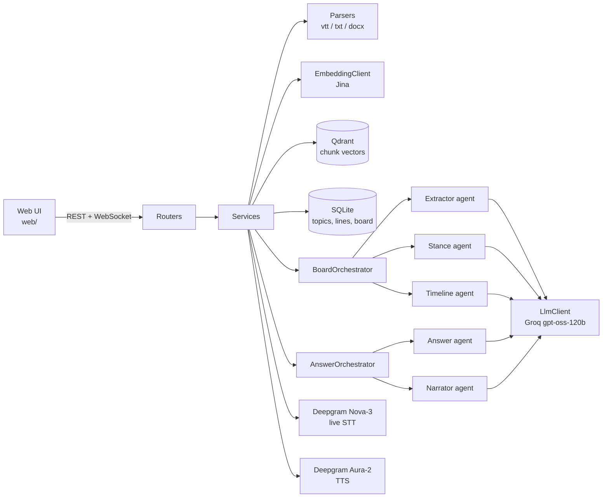

# ECHO: Voice Meeting Catch-Up (Multi-Agent)

ECHO helps someone who missed meetings catch up by voice. Upload meeting transcripts into a
topic, and ECHO builds a catch-up board (decisions and how they changed, action items with
owners, unowned work, open questions, inferred stances). Then tap the mic and ask, or press
"Catch me up" for a 30-second spoken briefing. Every answer links to the exact transcript lines
it is based on.

## What it does

- **Upload** `.vtt`, `.txt` or `.docx` transcripts. Date and title come from the file name
  (`2026-10-05_data-model-review.docx`). Empty, corrupt, wrong-type and duplicate files get a
  clear error and nothing is stored.
- **Board per topic**, rebuilt after every upload:
  - decisions, with the current version first and older versions kept as history
  - action items with owner and due date, done items marked, "nobody owns this yet" for work
    no one took
  - open questions, with the meeting where they were raised
  - inferred stances (labelled "Inferred", only with two or more quotes spoken by that person)
  - a timeline of how decisions changed
- **Ask by voice or text.** Answers are short and spoken. ECHO says "That wasn't discussed in
  these meetings" when the transcripts do not cover it, and asks back when a question is vague.
  Follow-ups ("who owns it?") use the recent conversation.
- **Barge-in.** Start talking while ECHO speaks and it stops at once.
- **Grounded citations.** The LLM only returns line numbers. Code copies the quote from the
  stored transcript and drops any citation that does not exist or was not shown to the agent.
  Clicking a quote opens the transcript at that line.

## Quick start (Windows, PowerShell)

```powershell
git clone https://github.com/engineer-husnain21/echo-meeting-catchup.git
cd echo-meeting-catchup
python -m venv .venv
.\.venv\Scripts\Activate.ps1
pip install -r requirements-dev.txt
copy .env.example .env      # then put your own free keys in .env
python -m pytest -q         # 142 tests, no keys or network needed
uvicorn app.main:app --reload
```

Open http://127.0.0.1:8000/ for the app and http://127.0.0.1:8000/docs for the API.

Getting the four free keys takes about 15 minutes: see
[docs/resource-setup-guide.md](docs/resource-setup-guide.md).

## Try it with the sample data

The `data/` folder has a fake project, **Project Atlas**: five meetings over two weeks with
five speakers. `data/SAMPLE_DATA.md` lists everything planted in them.

1. Add a topic "Project Atlas" and upload the five files from `data/project_atlas/`.
2. Type `Hussnain Razaq` under "You are" (he is the demo user who missed meetings 3 to 5).
3. Press **Catch me up**, then tap the circle and ask, for example:
   - "Which database are we using?" (changed from PostgreSQL to MongoDB)
   - "What do I need to do this week?"
   - "Who owns the on-call runbook?" (nobody)
   - "What about the budget?" (vague: hosting or team budget?)
   - "What's the mobile app plan?" (not discussed)
4. Upload `data/project_atlas_extra/2026-10-12_database-review.vtt` and ask about the database
   again: the decision moves back to PostgreSQL with JSONB, and the history shows all three steps.
5. Edge cases live in `data/test_files/` (prompt injection, empty, wrong type, corrupt Word).

## How it works



Every request follows the team guide in `CLAUDE.md`: routers call one service, services call
orchestrators and repositories, orchestrators run agents, agents only talk to the LLM through
the `LlmClient` Protocol, and only `clients/` call outside APIs.

### Agents (one job each, prompts in `app/prompts/`)

| Agent | Reads | Returns |
|---|---|---|
| Extractor | One meeting (in windows of 150 lines for long meetings) plus the items known so far | Decisions, action items, open items, each with line numbers |
| Stance | All meetings of the topic, tagged `[M3 L14]`, sampled to 400 lines | Hidden leanings with trend (softened, hardened, reversed) and proof lines |
| Timeline | The merged decision history | How and why each decision changed |
| Answer | The board plus the transcript chunks found for the question, and recent turns | `answered`, `not_discussed` or `clarify`, with line citations |
| Narrator | The board and the listener's name | A short spoken briefing with citations |

### Board building

1. On upload, the transcript is parsed into lines, stored in SQLite, cut into chunks of 6 lines
   (overlap 2), embedded with Jina and stored in Qdrant.
2. The Extractor runs once per meeting. Results are cached per meeting, so a new upload only
   reads the new meeting (`?rebuild=true` re-reads all of them).
3. `BoardMergeService` merges meetings by subject: the latest decision wins and older ones become
   history, action items keep their owner unless a new one is named, an open item disappears
   once a later decision settles it.
4. Stance and Timeline run on the whole topic. Anything whose cited lines do not exist is dropped
   and counted in `dropped_ungrounded`.

### Voice

The browser records the mic (`MediaRecorder`, webm/opus) and streams it to
`WS /api/v1/voice/transcribe`. The backend forwards it to Deepgram, so the key never reaches the
browser. A KeepAlive is sent every 4 seconds so the stream survives while ECHO talks. When
Deepgram marks the end of speech, the UI sends the question, gets the answer and plays it from
`POST /api/v1/voice/speech` (Aura-2 MP3). Partial transcripts with two or more words stop
playback (barge-in). Words that match ECHO's own current answer are ignored, so its voice from
the speakers does not interrupt itself.

### API

| Method | Path | What |
|---|---|---|
| GET | `/api/v1/health` | Health check |
| POST, GET | `/api/v1/topics` | Create or list topics |
| POST | `/api/v1/topics/{id}/meetings` | Upload a transcript (multipart `file`) |
| GET | `/api/v1/topics/{id}/meetings`, `/speakers` | Meetings and speakers of a topic |
| GET | `/api/v1/meetings/{id}/transcript` | All lines of a meeting |
| GET | `/api/v1/topics/{id}/board` | The stored board |
| POST | `/api/v1/topics/{id}/board/refresh?rebuild=` | Rebuild the board |
| GET | `/api/v1/topics/{id}/board/my-action-items?name=` | One person's action items |
| POST | `/api/v1/topics/{id}/questions` | Ask a question (`question`, `history`, `user_name`) |
| POST | `/api/v1/topics/{id}/briefing` | Spoken catch-up briefing |
| WS | `/api/v1/voice/transcribe` | Live speech-to-text |
| POST | `/api/v1/voice/speech` | Text to MP3 |

## Stack and why

All services have a free tier, and every provider is behind a Protocol, so switching is a
`.env` change.

| Need | Choice | Why |
|---|---|---|
| LLM | Groq `openai/gpt-oss-120b` (OpenAI-compatible) | Fast enough for voice, JSON mode, free daily tokens. `LLM_REASONING_EFFORT=medium` gave a clearly better board than `low` (done items, separate tasks) |
| Embeddings | Jina `jina-embeddings-v3`, 768 dims | Gemini embeddings were tried first, but the AI Studio project returned 403 "project denied access" |
| Vector store | Qdrant Cloud free cluster | Managed, filter by topic, async client |
| Speech | Deepgram Nova-3 streaming STT and Aura-2 TTS | Low latency, end-of-speech events, one key for both, $200 free credit |
| Data | SQLite with async SQLAlchemy | Zero setup for a POC, swappable through `DATABASE_URL` |
| API | FastAPI | Async, WebSockets, automatic `/docs` |
| UI | Plain HTML, CSS and JS modules in `web/` | No build step, served by FastAPI |

## Network problems we hit (and the fixes)

- **Qdrant on office WiFi:** port 6333 is blocked. Put `:443` at the end of `QDRANT_URL`.
- **Deepgram on office WiFi:** the WiFi DNS server fails to resolve `api.deepgram.com`
  (`getaddrinfo failed`). Set the adapter DNS to `8.8.8.8` / `1.1.1.1`, or use a mobile hotspot.
  The Deepgram signup page also needed mobile data.
- **Groq free tier rate limits:** the LLM client waits and retries on HTTP 429
  (`LLM_RATE_LIMIT_RETRIES`). Each meeting extraction is saved at once, so a failure later in
  the run does not waste tokens already spent.

## Tests and quality

```powershell
python -m pytest -q     # 142 tests: unit tests mirror app/, integration tests cover full flows
ruff check .            # lint
mypy app                # strict typing
```

Unit tests never call real APIs. They use fake LLM, embedding and speech clients, an in-memory
SQLite database, in-memory Qdrant and a local fake Deepgram WebSocket server. A 3+ hour meeting
(2,200 lines) is generated inside a test to check windowed extraction and stance sampling.
`pre-commit` runs ruff and mypy before every commit.

**Tested with real keys:** upload and indexing, board building, questions, briefing, TTS, live
STT, the browser voice loop and barge-in. The very long meeting was tested only with fakes, to
save free-tier tokens.

## Known limits

- The board comes from an LLM, so results vary a little between rebuilds. Grounding guarantees
  every quote is real, not that every item is perfectly classified (for example an unowned task
  can show up as an open question).
- One user, no login. The name typed under "You are" decides which action items are "yours".
- English transcripts only.

## Project structure

```
app/            backend, layered as in CLAUDE.md (routers, services, orchestrators, agents,
                clients, repositories, parsers, schemas, models, prompts, core, db)
web/            UI (index.html, styles.css, app.js, board.js, voice.js, api.js, format.js)
tests/          unit/ mirrors app/, integration/ covers full flows, fakes/ has fake clients
data/           Project Atlas sample meetings and edge-case files
docs/           resource setup guide
```
